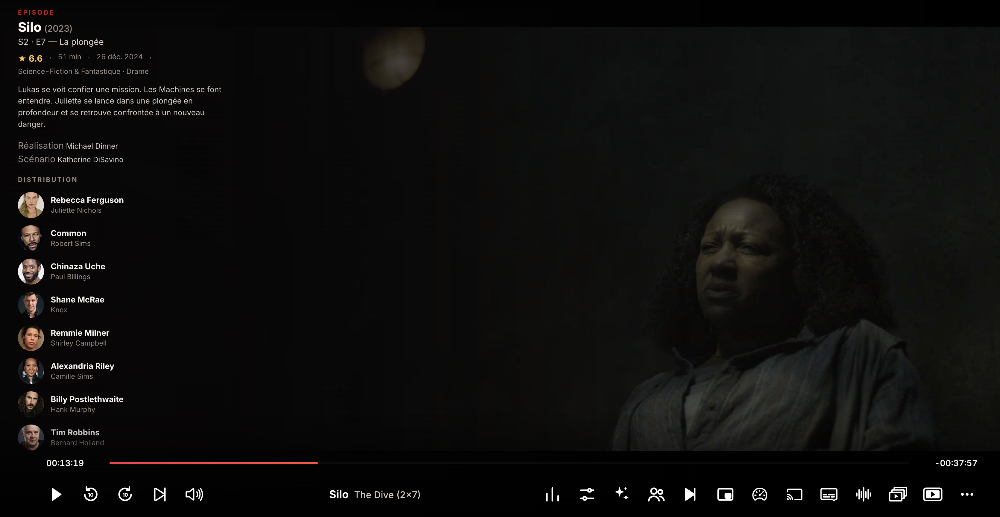

# XRay for dx.bi

**Pause the video, meet the cast.** An Amazon X-Ray–style panel for [dx.bi](https://github.com/notdxbi/dxbi-stremio) (and Stremio Enhanced): when you pause, the cast of the episode or film slides in on the left — photos, character names, guest stars — together with the episode's title, rating, runtime, air date, synopsis, director and writers.

## Features

- Opens automatically on pause, closes on play (can be switched off). Press **X** at any time to show or hide it.
- Episode-level data: title, synopsis, rating, runtime, air date, director, writers, main cast **and the guest stars of that very episode**.
- Works with every catalog: Cinemeta, TMDB catalogs, AIOStreams, Kitsu (anime) and custom catalogs. Titles are resolved by IMDb id, TMDB id, the catalog's own metadata, and finally by name.
- Honest about uncertainty: when a title could only be matched by its name (no standard id), the panel shows the series/film overview only and says so — it never guesses an episode.
- Click an actor to search for them in dx.bi.
- Never covers the player: the back arrow, fullscreen button, progress bar and controls stay on top and clickable. A soft left-to-right gradient dims the picture while the panel is open.
- French and English (TMDB data language is selectable).

## Install

1. Download [`xray.plugin.js`](https://raw.githubusercontent.com/Tipapoute/xray-dbxi/main/xray.plugin.js) (right-click → *Save link as…*).
2. In dx.bi: **Settings → dx.bi → Plugins → Open Plugins Folder**, drop the file there, then switch the plugin on (quit and reopen the Settings page if it does not show up).
3. Get a free TMDB API key: [themoviedb.org](https://www.themoviedb.org/) → account → *Settings → API → Create* (type *Developer*; the form is not verified). Copy the **API Key**.
4. In dx.bi: **Settings → dx.bi → Plugins → ⚙️ next to XRay**, paste the key.

dx.bi checks this repository for updates, so new versions install themselves.

## Options

| Option | Default | What it does |
| --- | --- | --- |
| TMDB API key | – | Required. Free, see above. |
| Show automatically on pause | on | Panel appears on pause, disappears on play. **X** always works. |
| Info language | French | Language of synopses and character names (TMDB). |

## Limits

- Cast and crew are per episode / film, not per scene (Amazon annotates its films by hand; we rely on TMDB).
- Content that is not on TMDB (fan edits, live TV, YouTube) shows the closest series/film by name, flagged as approximate, or nothing.
- With the mpv player enabled in dx.bi, the pause is not detected; use the **X** key.

## Credits

Made by **Tipapoute**. Data from [TMDB](https://www.themoviedb.org/) — this product uses the TMDB API but is not endorsed or certified by TMDB. Built for [dx.bi](https://github.com/notdxbi/dxbi-stremio).

## License

MIT
